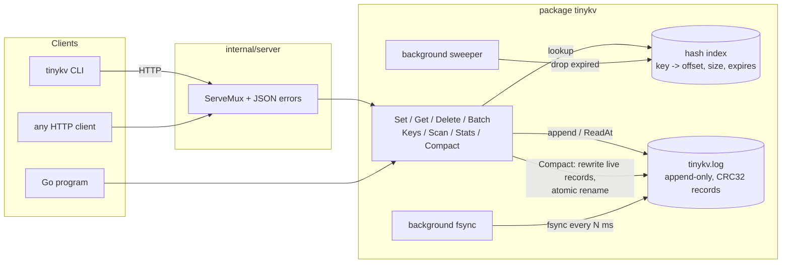

# tinykv

[](https://github.com/sumit-do/tinykv/actions/workflows/ci.yml)
[](https://github.com/sumit-do/tinykv/releases/latest)
[](https://pkg.go.dev/github.com/sumit-do/tinykv)

[](LICENSE)

A small, persistent, embedded key-value store in pure Go, with an HTTP server and a CLI.
Standard library only, no dependencies.

- **Append-only write-ahead log** with length-prefixed, CRC32-checksummed records
- **In-memory hash index** (Bitcask-style): `Get` is one map lookup and one positional read
- **Crash recovery**: `Open` replays the log and truncates a torn or corrupt tail
- **Compaction** that rewrites live data into a fresh log and swaps it in atomically, while reads keep flowing
- **TTL** per key, with lazy expiry on read and a background sweeper
- **Configurable fsync** policy: every write, every N milliseconds, or never
- **Sorted prefix iteration**: `Keys(prefix)` and `Scan(prefix, fn)`
- **HTTP API** with JSON errors, atomic batches and graceful shutdown
- **CLI** for running a server and talking to it

```go
db, _ := tinykv.Open("data", tinykv.Options{})
db.Set("user:1", []byte("Ada"))
db.SetTTL("session:abc", []byte("token"), 30*time.Minute)
v, _ := db.Get("user:1")
```

## On-disk format

The data directory holds a single file, `tinykv.log`, which is a sequence of records.
Writes append; nothing is ever updated in place.

```
tinykv.log
┌──────────┬──────────┬──────────┬───────────────┐
│ record 0 │ record 1 │ record 2 │  ...          │
└──────────┴──────────┴──────────┴───────────────┘

record (all integers little-endian)
┌─────────┬──────────┬─────────┬──────────────┬──────────┬────────────┬──────────────┐
│ len u32 │ crc32 u32│ op u8   │ expires i64  │ klen u32 │ key        │ value        │
│ 4 bytes │ 4 bytes  │ 1 byte  │ 8 bytes      │ 4 bytes  │ klen bytes │ len-13-klen  │
└─────────┴──────────┴─────────┴──────────────┴──────────┴────────────┴──────────────┘
│<---- header ------>│<------------------------ payload (len bytes) ----------------->│
                     │<------------------- covered by crc32 (IEEE) ------------------->│
```

- `op` is `1` (set) or `2` (delete tombstone). Tombstones have an empty value.
- `expires` is a Unix timestamp in nanoseconds; `0` means the key never expires.
- A record is valid only if its header is complete, `len` is sane, the payload is complete,
  and the CRC matches. The first record that fails any of these checks ends the log: `Open`
  truncates the file there and logs a warning.

## Architecture



Request path for `Get(key)`: take the read lock, look the key up in the index, check its
expiry, `ReadAt` the value bytes from the log, release the lock. No write-side work happens on
reads, and no reads touch the disk for keys that do not exist.

Request path for `Set(key, value)`: take the writer lock, encode the record, `WriteAt` it at the
end of the log, fsync (depending on policy), then take the write lock for a moment to publish
the new index entry and the new file size.

## Install

Download a prebuilt binary for Linux, macOS or Windows from the
[latest release](https://github.com/sumit-do/tinykv/releases/latest), or build from source:

```sh
go install github.com/sumit-do/tinykv/cmd/tinykv@latest
tinykv version
```

## Quick start

### As a library

```go
package main

import (
	"fmt"
	"time"

	"github.com/sumit-do/tinykv"
)

func main() {
	db, err := tinykv.Open("data", tinykv.Options{
		Sync:         tinykv.SyncInterval, // or SyncAlways (default) / SyncNever
		SyncInterval: 100 * time.Millisecond,
	})
	if err != nil {
		panic(err)
	}
	defer db.Close()

	db.Set("user:1:name", []byte("Ada"))
	db.SetTTL("session:abc", []byte("token"), 30*time.Minute)

	// Several operations, one append, one index update.
	db.Batch([]tinykv.Op{
		{Type: tinykv.OpSet, Key: "user:2:name", Value: []byte("Grace")},
		{Type: tinykv.OpDelete, Key: "user:1:name"},
	})

	db.Scan("user:", func(key string, value []byte) error {
		fmt.Printf("%s = %s\n", key, value)
		return nil // or tinykv.ErrStopScan
	})

	st, _ := db.Stats()
	fmt.Printf("%d keys, %d dead bytes\n", st.Keys, st.DeadBytes)
	db.Compact()
}
```

A complete runnable version lives in [`examples/library`](examples/library/main.go):
`go run ./examples/library`.

### As a server

```sh
go install github.com/sumit-do/tinykv/cmd/tinykv@latest

tinykv serve --dir data --addr :7700 --fsync always
```

```sh
curl -X PUT  localhost:7700/kv/greeting -d 'hello'
curl -X PUT  'localhost:7700/kv/session?ttl=30s' -d 'token'
curl         localhost:7700/kv/greeting              # hello
curl         'localhost:7700/kv?prefix=gr'           # {"keys":["greeting"],"count":1}
curl -X POST localhost:7700/batch -d '[{"op":"set","key":"a","value":"1"},{"op":"delete","key":"greeting"}]'
curl         localhost:7700/stats
curl -X POST localhost:7700/compact
```

Or with Docker:

```sh
docker build -t tinykv .
docker run --rm -p 7700:7700 -v tinykv-data:/data tinykv
```

## HTTP API

| Method | Path                     | Body / query                                   | Success                          |
| ------ | ------------------------ | ---------------------------------------------- | -------------------------------- |
| GET    | `/kv/{key}`              |                                                | `200` raw value bytes            |
| PUT    | `/kv/{key}[?ttl=30s]`    | raw value bytes; `ttl` is a Go duration        | `204`                            |
| DELETE | `/kv/{key}`              |                                                | `204`                            |
| GET    | `/kv?prefix=p`           | `prefix` optional                              | `200 {"keys":[...],"count":n}`   |
| POST   | `/batch`                 | JSON array of `{"op","key","value","ttl"}`     | `200 {"applied":n}`              |
| GET    | `/stats`                 |                                                | `200` [`Stats`](db.go) as JSON   |
| POST   | `/compact`               |                                                | `200 {"before","after","duration_ms"}` |
| GET    | `/healthz`               |                                                | `200 {"status":"ok"}`            |

Keys may contain `/` and any URL-escaped character. Batch ops are `set` or `delete`; a batch
is validated in full before anything is written, and is applied under a single writer lock so
readers never observe a partially applied batch.

Every error is JSON: `{"error":"key not found"}`, with the usual status codes
(`400` bad input, `404` missing key, `405` wrong method, `413` body too large, `500`/`503`).

## CLI

```
tinykv serve   [--dir data] [--addr :7700] [--fsync always|never|<interval>] [--sweep 1m] [--log-level info]
tinykv get     [--addr :7700] <key>
tinykv set     [--addr :7700] [--ttl 30s] <key> <value>
tinykv del     [--addr :7700] <key>
tinykv keys    [--addr :7700] [prefix]
tinykv stats   [--addr :7700]
tinykv compact [--addr :7700]
```

`--addr` accepts `:7700`, `host:7700` or a full URL, and defaults to `$TINYKV_ADDR` or
`:7700`. Flags come before positional arguments. Exit codes: `0` ok, `1` error, `2` usage,
`3` key not found.

## Benchmarks

Measured with `go test -bench . -benchmem -run '^$'` on a 12th Gen Intel Core i3-1220P,
Windows 11, NVMe SSD, Go 1.27, `SyncNever`, 10 000 keys, 100-byte values:

| Benchmark             | ns/op  | MB/s  | B/op | allocs/op |
| --------------------- | ------:| -----:| ----:| ---------:|
| BenchmarkSet          | 11 457 |  8.73 |  220 |         2 |
| BenchmarkGet          |  9 276 | 10.78 |  112 |         1 |
| BenchmarkMixed (80/20)|  9 932 | 10.07 |  131 |         1 |
| BenchmarkGetParallel  | 12 322 |  8.12 |  112 |         1 |

Reading the numbers: every `Get` is a real positional read syscall (values are not cached in
memory) and every `Set` is a real `WriteAt`, so the per-op cost is dominated by the OS. On
Windows, `ReadAt`/`WriteAt` are emulated with a seek under a file lock, which is why the
parallel read benchmark does not scale; the same code on Linux uses `pread`/`pwrite` and is
several times faster. Allocation counts are the more portable signal: one allocation per read
(the returned value) and two per write (encoded record plus the batch slice).

With `SyncAlways` throughput is bounded by the storage device's fsync latency (typically
hundreds of microseconds to a few milliseconds per write); `SyncInterval` with a 100 ms window
recovers almost all of the `SyncNever` throughput while bounding data loss to one interval.

## Design decisions and tradeoffs

**Log-structured, single file.** Every mutation is an append. This makes writes sequential,
makes durability a matter of one `fsync`, and makes crash recovery trivial: the prefix of the
file that passes checksums is exactly the committed state. The cost is space amplification:
overwrites and deletes leave dead bytes behind until compaction runs. `Stats()` exposes
`DeadBytes` so callers can decide when to compact.

**Hash index in memory.** The whole key set must fit in RAM (roughly 60-80 bytes of overhead
per key plus the key itself), which bounds the store to tens of millions of keys. In exchange,
`Get` is O(1) and never touches disk for a missing key. Values live on disk only, so memory use
is independent of value size. Startup time is proportional to the log size because the log must
be replayed; a hint file (index snapshot) is the standard remedy and is on the roadmap.

**Sorted iteration over a hash index.** `Keys(prefix)` walks the entire index, filters by
prefix, then sorts: O(n + m log m). This is the right call when point lookups dominate and
listings are occasional (an admin UI, a debug call). A workload with frequent range scans
would want a sorted index (B-tree or radix tree) and would pay for it on every write; keeping
the hash map keeps the write path a single map assignment. `Scan` snapshots the keys under the
read lock and then reads each value separately, so writers are not blocked for the duration of
a long scan, at the cost of not being a point-in-time snapshot.

**Two locks.** A `sync.Mutex` serializes writers (including compaction); a `sync.RWMutex`
guards the index and file handle. A writer appends while holding only the writer lock, then
takes the write lock for the few nanoseconds needed to publish index entries. Readers only read
offsets that are already published, so an in-flight append can never be observed. Compaction
holds the writer lock throughout (other writers wait) but readers are served from the old file
until the final swap, which happens under the write lock. The full model is documented in
[`db.go`](db.go).

**Compaction by copy and rename.** Live records are copied (and re-verified against their CRC)
into `tinykv.log.compact`, fsynced, and renamed over the original. If the process dies before
the rename, `Open` deletes the leftover and the original log is still authoritative. The old
file is closed before the rename so the swap also works on Windows, where an open file cannot
be replaced.

**TTL without tombstones.** The expiry timestamp travels inside the record. Reads treat an
expired entry as absent, the sweeper drops expired entries from the index with no disk I/O,
replay skips records that have expired by the time of `Open`, and compaction drops them from the
new file. Nothing extra is written when a key expires. The tradeoff is that expiry is evaluated
against the local clock; a clock jump backwards can briefly resurrect expired keys until the
clock catches up.

**Configurable fsync.** `SyncAlways` gives per-write durability, `SyncInterval` gives a bounded
loss window with a background `fsync`, `SyncNever` trusts the OS. The record checksum makes all
three safe against corruption: a torn write on crash is detected and truncated, never served.

**Batch atomicity.** A batch is validated first, then encoded into one contiguous buffer and
written with one `WriteAt`, then published to the index under one write lock. Readers see all of
it or none of it. On crash mid-write, the torn tail is dropped as a unit (it is one or more
partial records), so a batch is also all-or-nothing on disk, as long as the OS does not
reorder the pages of a single write, which is a standard assumption for log-structured stores.

**Standard library only.** `net/http`'s pattern router (Go 1.22+) is enough for the API, and
`log/slog` for logging. Fewer dependencies means a smaller supply chain and a static binary under 8 MB.

## Development

```sh
make test     # go test -race ./...
make lint     # go vet + gofmt check
make bench    # benchmarks with -benchmem
make build    # static binary in bin/
make run      # build and serve on :7700
make docker   # multi-stage alpine image, non-root, /data volume
```

CI (`.github/workflows/ci.yml`) runs vet, gofmt, `go test -race`, a build and a benchmark smoke
on every push and pull request.

## Roadmap

- Hint file: persist the index on `Close`/`Compact` so `Open` does not replay the whole log
- Automatic compaction when `DeadBytes / FileSize` crosses a threshold
- Segmented log (multiple files) so compaction can run per segment and parallel reads avoid a
  single file lock on Windows
- Optional value cache for hot keys
- Directory lock file to refuse a second process opening the same data directory
- Snapshot/backup endpoint streaming a consistent copy of the log
- Range queries (`from`, `to`) once a sorted index becomes worth its write-side cost

## License

MIT. See [LICENSE](LICENSE).
